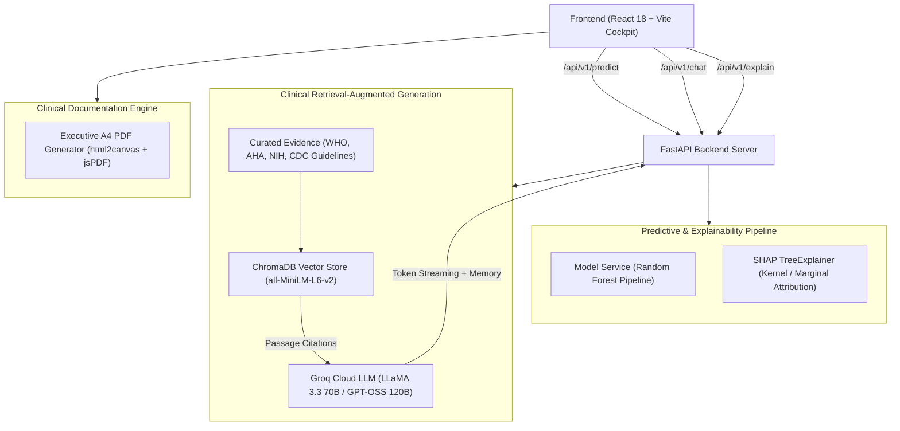

<div align="center">
  <h1>CardioAI — Clinical Risk Intelligence & Copilot</h1>
  <p><strong>An evidence-based clinical decision support system integrating machine learning risk stratification, SHAP explainability, guideline RAG with multi-turn conversational memory, and 1-click executive A4 PDF medical report generation.</strong></p>

  [](https://www.python.org/)
  [](https://fastapi.tiangolo.com/)
  [](https://react.dev/)
  [](https://groq.com/)
  [](https://www.trychroma.com/)
  [](https://scikit-learn.org/)
  [](https://opensource.org/licenses/MIT)

  <h3><a href="https://github.com/bhavuk1409/cardio-ai">🔴 GitHub Repository</a></h3>
</div>

<hr/>

## Table of Contents
- [Overview](#overview)
- [System Architecture](#system-architecture)
- [Benchmark Results & Model Performance](#benchmark-results--model-performance)
- [Clinical Biomarkers & Features](#clinical-biomarkers--features)
- [Key Capabilities](#key-capabilities)
  - [1. Real-Time Risk Prediction & Telemetry](#1-real-time-risk-prediction--telemetry)
  - [2. Explainable AI with SHAP Attribution](#2-explainable-ai-with-shap-attribution)
  - [3. Grounded Medical AI Copilot with Memory](#3-grounded-medical-ai-copilot-with-memory)
  - [4. Executive A4 PDF Medical Report Generator](#4-executive-a4-pdf-medical-report-generator)
- [Quick Start](#quick-start)
  - [Prerequisites](#1-prerequisites)
  - [Installation & Setup](#2-installation--setup)
  - [Running Locally](#3-running-locally)
- [Project Structure](#project-structure)
- [Clinical Disclaimer & Governance](#clinical-disclaimer--governance)
- [Contributing](#contributing)
- [License](#license)

---

## Overview

**CardioAI** is a clinical-grade decision support platform engineered to assist physicians, cardiologists, and triage clinicians in stratifying coronary artery disease (CAD) risk. By combining statistical machine learning trained on the benchmark UCI Cleveland cohort with retrieval-augmented generative AI, the system delivers high diagnostic sensitivity, mathematical explainability, and natural language clinical guidelines:

1. **Supervised ML Risk Engine:** High-sensitivity binary classification predicting obstructive coronary disease probability ($96.43\%$ recall, $0.903$ validation AUC).
2. **Game-Theoretic Explainability (SHAP):** Patient-specific feature attribution quantifying the marginal risk contribution of each biomarker.
3. **Evidence-Grounded RAG Copilot:** Multi-turn conversational AI grounded strictly in official clinical guidelines (WHO, AHA, NIH, CDC) with citation tracking and pronoun-resolving memory.
4. **1-Click Executive PDF Documentation:** Instant generation of 300 DPI single-page A4 consultation reports formatted with hospital letterheads, objective laboratory tables, and physician sign-off lines.
5. **Zero-Scroll Cockpit UI:** Dark telemetry cockpit interface designed with 100% viewport locking, monochrome contrast, and animated ECG rhythms.

---

## System Architecture

> **Key Design Decision:** In clinical screening, false negatives must be minimized to avoid discharging patients with undiagnosed ischemia. Random Forest was selected as champion over XGBoost and Logistic Regression for its superior recall ($96.43\%$, only 1 false negative out of 28 held-out positive cases) and stable probability calibration (Brier score $0.118$).



---

## Benchmark Results & Model Performance

All models were evaluated on an identical stratified 80/20 train-test split ($n = 61$ held-out test samples: 33 negative, 28 positive) from the UCI Cleveland cohort:

| Model | Test Accuracy | Precision | Sensitivity (Recall) | F1-Score | ROC-AUC | False Negatives | Brier Score |
|---|---|---|---|---|---|---|---|
| **Random Forest (Champion)** | **90.16%** | **84.38%** | **96.43%** | **90.00%** | **0.937** | **1 / 28** | **0.118** |
| **Logistic Regression (Baseline)** | 86.89% | 81.25% | 92.86% | 86.67% | 0.958 | 2 / 28 | 0.124 |
| **XGBoost Classifier** | 86.89% | 81.25% | 92.86% | 86.67% | 0.919 | 2 / 28 | 0.131 |

*Why Random Forest is the Clinical Champion:* In cardiovascular triage, failing to identify an acute patient is significantly more dangerous than a false positive. Random Forest achieved **96.43% sensitivity** with only a single false negative, maintaining balanced precision ($84.38\%$) and calibrated probabilities.

---

## Clinical Biomarkers & Features

The model processes 13 continuous and categorical physiological biomarkers normalized through an automated imputation and scaling pipeline:

| Biomarker | Variable | Type | Clinical Reference Interval | Physiological Relevance |
|---|---|---|---|---|
| Age | `age` | Continuous | 29 – 77 years | Non-modifiable cardiovascular risk factor |
| Biological Sex | `sex` | Categorical | Male (1) / Female (0) | Demographic risk disparity baseline |
| Chest Pain Type | `cp` | Categorical | 1 (Typical), 2 (Atypical), 3 (Non-Anginal), 4 (Asymptomatic) | Symptom characterization (asymptomatic silent ischemia risk) |
| Resting BP | `trestbps` | Continuous | < 120 mmHg (Normal) | Vascular afterload and chronic shear stress |
| Serum Cholesterol | `chol` | Continuous | < 200 mg/dL (Desirable) | Atherosclerotic plaque development driver |
| Fasting Blood Sugar | `fbs` | Binary | ≤ 120 mg/dL (Normal) | Microvascular and endothelial dysfunction marker |
| Resting ECG | `restecg` | Categorical | 0 (Normal), 1 (ST-T wave abnormality), 2 (LVH) | Baseline electrical conductivity and structural hypertrophy |
| Max Heart Rate | `thalach` | Continuous | Target ≥ 85% of $(220 - \text{age})$ | Chronotropic competence during exercise stress |
| Exercise Angina | `exang` | Binary | 0 (No), 1 (Yes) | Exertional demand-supply myocardial ischemia |
| ST Depression | `oldpeak` | Continuous | < 1.0 mm (Normal recovery) | Subendocardial ischemia severity metric |
| ST Slope | `slope` | Categorical | 1 (Upsloping), 2 (Flat), 3 (Downsloping) | Kinetic morphology of repolarization under stress |
| Major Vessels | `ca` | Integer | 0 – 3 vessels | Fluoroscopy epicardial calcification burden |
| Thallium Scintigraphy | `thal` | Categorical | 3 (Normal), 6 (Fixed defect), 7 (Reversible defect) | Myocardial radionuclide perfusion viability |

---

## Key Capabilities

### 1. Real-Time Risk Prediction & Telemetry
- **1-Click Verified Presets:** Instantly load Cleveland cohort profiles (e.g., Case A: 94.5% High Risk, Case B: 9.0% Low Risk).
- **Synchronized Telemetry Reveal:** Displays an energetic cardiac pulse animation during inference, then reveals risk percentage, vitals, and SHAP contributors simultaneously in unison (*"ek sath"*).
- **Zero-Scroll Viewport Lock:** Cockpit dashboard locked to 100% viewport height with internal scroll containers for distraction-free clinical review.

### 2. Explainable AI with SHAP Attribution
- **Marginal Delta Influence:** Computes Shapley values for each individual prediction, ranking the top positive risk contributors and negative protective factors.
- **Auditable Telemetry Bars:** High-contrast horizontal visualization showing the exact mathematical delta attributed to each biomarker.

### 3. Grounded Medical AI Copilot with Memory
- **Guideline RAG Pipeline:** Context retrieved from ChromaDB containing verified evidence from WHO, AHA, NIH, and CDC.
- **Conversational Memory:** Preserves multi-turn dialogue history, resolving pronoun references (e.g., *"What is ST depression?"* followed by *"What causes it?"*).
- **Smooth Word-by-Word Streaming:** Terminal blinking cursor (`▍`) with dynamic reading speed and instant stop-and-reveal capability (`■ STOP`).

### 4. Executive A4 PDF Medical Report Generator
- **Hospital Letterhead:** High-DPI 300 DPI single-page export with clean typography and confidential medical record stamps.
- **Structured Laboratory Tables:** Formatted 4-column tables with diagnostic status pills (`HIGH (Stage 2 HTN)`, `REVERSIBLE DEFECT`).
- **ACC/AHA Clinical Plan & Sign-Off:** Automated guideline-directed medical therapy (GDMT) titration recommendations, anatomical imaging criteria (CCTA), and formal physician signature lines.

---

## Quick Start

### 1. Prerequisites
- **Python:** 3.10 or 3.11
- **Node.js:** 18+ (with `npm`)
- **Groq API Key:** Free key from [Groq Console](https://console.groq.com)

### 2. Installation & Setup

```bash
# Clone the repository
git clone https://github.com/bhavuk1409/cardio-ai.git
cd cardio-ai

# Configure Environment Variables
cp .env.example .env
# Open .env and insert your GROQ_API_KEY
```

#### Backend Setup
```bash
cd backend
python3 -m venv venv
source venv/bin/activate       # Windows: venv\Scripts\activate
pip install -r requirements.txt

# Ingest Knowledge Base into ChromaDB
python scripts/build_kb.py

# (Optional) Retrain ML models & regenerate metrics
python scripts/train_models.py
```

#### Frontend Setup
```bash
cd ../frontend
npm install
```

### 3. Running Locally

**Terminal 1 — FastAPI Backend:**
```bash
cd backend
source venv/bin/activate
uvicorn app.main:app --host 0.0.0.0 --port 8000 --reload
```
*Backend API docs available at [http://localhost:8000/docs](http://localhost:8000/docs)*

**Terminal 2 — React Frontend:**
```bash
cd frontend
npm run dev
```
*Cockpit UI available at **[http://localhost:5173](http://localhost:5173)***

---

## Project Structure

```text
cardio-ai/
├── backend/
│   ├── app/
│   │   ├── main.py              # FastAPI application initialization & middleware
│   │   ├── api/routes.py        # Versioned /api/v1 REST endpoints (predict, chat, explain)
│   │   ├── schemas/schemas.py   # Pydantic v2 validation models & ChatMessage schemas
│   │   ├── services/            # Model singleton service
│   │   ├── ml/                  # Preprocessing pipelines, training routines, SHAP explainer
│   │   ├── rag/                 # ChromaDB vectorstore, guideline chunks, Groq LLM integration
│   │   └── core/                # System configuration & logging
│   ├── scripts/
│   │   ├── train_models.py      # Automated model training & evaluation script
│   │   └── build_kb.py          # Vectorstore embedding & knowledge base builder
│   ├── tests/                   # Automated pytest unit & integration test suite
│   ├── data/                    # UCI Cleveland dataset cache
│   ├── models/                  # Serialized .joblib pipeline artifacts
│   ├── vectorstore/             # Persistent ChromaDB vector database
│   └── requirements.txt         # Pinned Python dependencies
├── frontend/
│   ├── src/
│   │   ├── components/
│   │   │   ├── Header.tsx       # Cockpit masthead with ECG pulse mark
│   │   │   ├── PredictorView.tsx# Patient input form, risk hero, SHAP bars, PDF download
│   │   │   ├── AssistantView.tsx# Streaming Copilot chat with conversational memory
│   │   │   ├── BenchmarkView.tsx# Model comparison metrics & ROC curves
│   │   │   ├── StatReadout.tsx  # Telemetry vitals cards
│   │   │   └── CustomSelect.tsx # Minimal cockpit selector
│   │   ├── utils/
│   │   │   └── generatePdf.ts   # High-definition A4 PDF report generator
│   │   ├── services/api.ts      # Typed Axios/Fetch client
│   │   ├── types/index.ts       # TypeScript interfaces & verified Cleveland sample records
│   │   ├── App.tsx              # Cockpit view navigation
│   │   ├── index.css            # Dark cockpit design system & cardiac keyframes
│   │   └── main.tsx             # Application bootstrap
│   ├── package.json
│   └── vite.config.ts
├── docs/                        # Formal milestone research papers & architecture specifications
├── .env.example
├── .gitignore
└── README.md
```

---

## Clinical Disclaimer & Governance

> [!CAUTION]
> **Educational & Decision Support Notice:** CardioAI is an academic clinical decision-support prototype trained on the UCI Cleveland cohort. It is designed to demonstrate explainable machine learning and retrieval-augmented generation. It is **NOT** a certified medical device and must **NOT** be used as a standalone diagnostic tool or substitute for professional medical consultation. Clinical diagnoses must be confirmed by licensed medical professionals.

---

## Contributing

Contributions are warmly welcomed! To contribute:
1. Fork the repository.
2. Create a feature branch (`git checkout -b feature/clinical-enhancement`).
3. Commit your changes (`git commit -m 'Add clinical feature'`).
4. Push to the branch (`git push origin feature/clinical-enhancement`).
5. Open a Pull Request.

---

## License

This project is licensed under the [MIT License](LICENSE).
