# System Architecture

## Project Title
**AI-Driven Clinical Risk Prediction and Context-Aware Medical Information Retrieval**  
*A Cardiovascular Risk Prediction Case Study using Machine Learning, Retrieval-Augmented Generation (RAG), SHAP and Large Language Models.*

**Team Members:**
- Bhavuk Agrawal — E23CSEU1938
- Goyal Annayan — E23CSEU1937

---

## 1. High-Level Architecture Overview

The system is designed with strict decoupling between the numerical Machine Learning Risk Prediction pipeline and the Retrieval-Augmented Generation (RAG) conversational pipeline. This guarantees that generative language models never hallucinate or alter clinical risk probabilities produced by the empirical classification models.

```mermaid
flowchart TD
    subgraph Client ["Client Layer (React + Vite + TypeScript)"]
        UI_Overview["Overview Dashboard"]
        UI_Predict["Risk Prediction Form"]
        UI_Performance["Model Comparison & Confusion Matrix"]
        UI_Explain["SHAP Explainability View"]
        UI_Chat["RAG Medical AI Assistant"]
        UI_Sources["Knowledge Sources Browser"]
    end

    subgraph API ["Backend API Layer (FastAPI v1)"]
        Router["FastAPI Versioned Router (/api/v1)"]
        HealthEP["GET /health"]
        PredictEP["POST /predict"]
        ExplainEP["POST /explain"]
        MetricsEP["GET /model/metrics"]
        RetrieveEP["POST /rag/retrieve"]
        ChatEP["POST /chat"]
        SourcesEP["GET /knowledge/sources"]
    end

    subgraph ML_Engine ["Machine Learning Engine"]
        DatasetLoader["UCI Cleveland Data (ID 45)"]
        PreprocPipe["Scikit-Learn Preprocessor (Median Impute + Scale + OHE)"]
        LR_Model["Logistic Regression (Baseline)"]
        RF_Model["Random Forest (Champion)"]
        XGB_Model["XGBoost Classifier"]
        SHAP_Engine["SHAP Tree & Linear Explainers"]
    end

    subgraph RAG_Engine ["RAG & Medical Knowledge Engine"]
        KB_Manifest["Curated Medical Corpus (WHO, CDC, AHA, NIH)"]
        Chunker["Character Chunker (400 chars, 80 overlap)"]
        Embedder["Sentence-Transformers (all-MiniLM-L6-v2)"]
        VectorDB[("ChromaDB Persistent Store")]
        LLM_Service["Groq API (Llama 3.3 / Llama 3.1, Fallback: Ollama)"]
    end

    %% Client to API
    UI_Overview --> HealthEP & MetricsEP
    UI_Predict --> PredictEP
    UI_Performance --> MetricsEP
    UI_Explain --> ExplainEP
    UI_Chat --> ChatEP & RetrieveEP
    UI_Sources --> SourcesEP

    Router --> HealthEP & PredictEP & ExplainEP & MetricsEP & RetrieveEP & ChatEP & SourcesEP

    %% API to ML Engine
    PredictEP --> PreprocPipe --> RF_Model
    PredictEP -.-> LR_Model & XGB_Model
    ExplainEP --> SHAP_Engine
    MetricsEP --> LR_Model & RF_Model & XGB_Model

    %% API to RAG Engine
    RetrieveEP --> VectorDB
    ChatEP --> VectorDB --> LLM_Service
    KB_Manifest --> Chunker --> Embedder --> VectorDB
```

---

## 2. Component Breakdown

### 2.1 Frontend Client
- **Framework**: React 18, Vite, TypeScript.
- **Styling**: Tailwind CSS, strict light-mode medical aesthetic (Apple Health meets Linear).
- **Visualisations**: Recharts for ROC curves, metric comparisons, confusion matrices, and SHAP contribution bar charts.
- **Iconography**: Lucide React.
- **State & Routing**: Client-side single-page app via `react-router-dom`.

### 2.2 Backend Service (FastAPI)
- **Runtime**: Python 3.11 with Uvicorn ASGI server.
- **Validation**: Pydantic v2 schemas for all requests and responses, with rigorous boundary validation (`age` 1–120, `thalach` 50–250, `trestbps` 50–300, etc.).
- **Decoupled Services**:
  - `ModelService`: Manages loaded `.joblib` pipelines, inference execution, and metric reporting.
  - `RetrievalService`: Handles vector search against ChromaDB using cosine distance.
  - `LLMService`: Handles grounded prompt assembly, citation enforcement, and fallback handling when API credentials are absent.

### 2.3 Machine Learning Pipeline
1. **Source Data**: UCI Machine Learning Repository — Heart Disease (Cleveland subset, 303 records, 13 features).
2. **Target Binarization**: Original `num` target (0 = no disease, 1–4 = heart disease presence) is binarized to `0` vs `1`.
3. **Data Preprocessing**:
   - `SimpleImputer(strategy='median')` and `StandardScaler()` for continuous features (`age`, `trestbps`, `chol`, `thalach`, `oldpeak`, `sex`, `fbs`, `exang`, `ca`).
   - `SimpleImputer(strategy='most_frequent')` and `OneHotEncoder(handle_unknown='ignore')` for nominal categories (`cp`, `restecg`, `slope`, `thal`).
   - Stratified train/test split (80/20, seed 42) to prevent data leakage.
4. **Estimators**:
   - **Logistic Regression**: Interpretable linear baseline with balanced class weights.
   - **Random Forest**: Ensemble of 200 trees, balanced class weights, robust to outliers.
   - **XGBoost**: Gradient boosted decision trees with `scale_pos_weight` class imbalance handling.
5. **Explainability**:
   - `shap.TreeExplainer` for Random Forest and XGBoost.
   - `shap.LinearExplainer` for Logistic Regression.
   - Extracts local feature contributions with magnitude and directional impact (+/- disease risk).

### 2.4 Retrieval-Augmented Generation (RAG)
1. **Source Manifest**: Verified medical text excerpts from World Health Organization (WHO), Centers for Disease Control and Prevention (CDC), American Heart Association (AHA), and National Institutes of Health (NIH/NHLBI).
2. **Chunking**: Fixed character-level chunking (400 characters, 80 characters overlap) retaining document title, organization, section, and canonical URL.
3. **Embeddings**: `sentence-transformers/all-MiniLM-L6-v2` (384-dimensional dense vectors).
4. **Vector Database**: ChromaDB persistent client (`HNSW` cosine similarity index).
5. **Generation**: Groq API (`llama-3.3-70b-versatile` / `llama-3.1-8b-instant`) with constrained medical system prompt; gracefully degrades to pure retrieval if `GROQ_API_KEY` is not configured.
